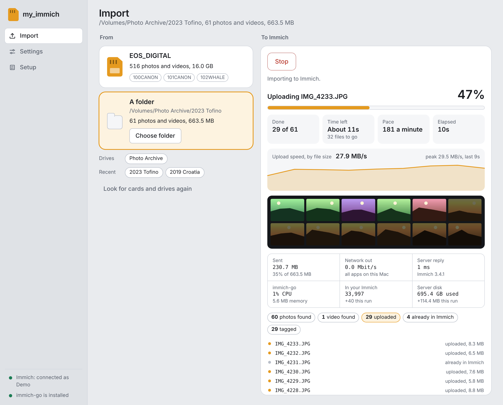
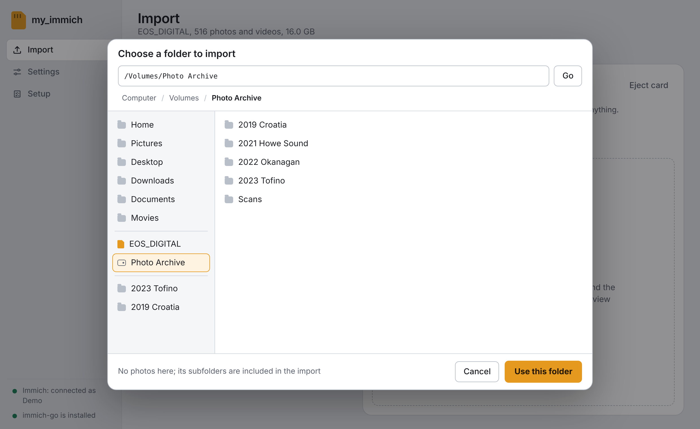
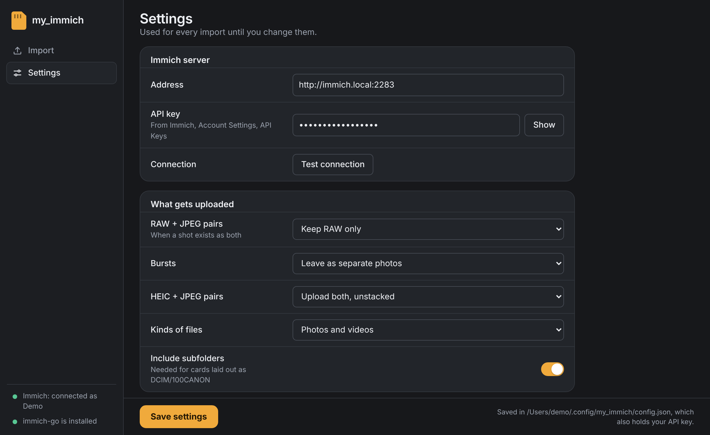
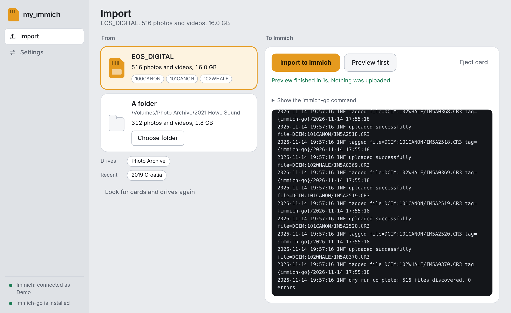
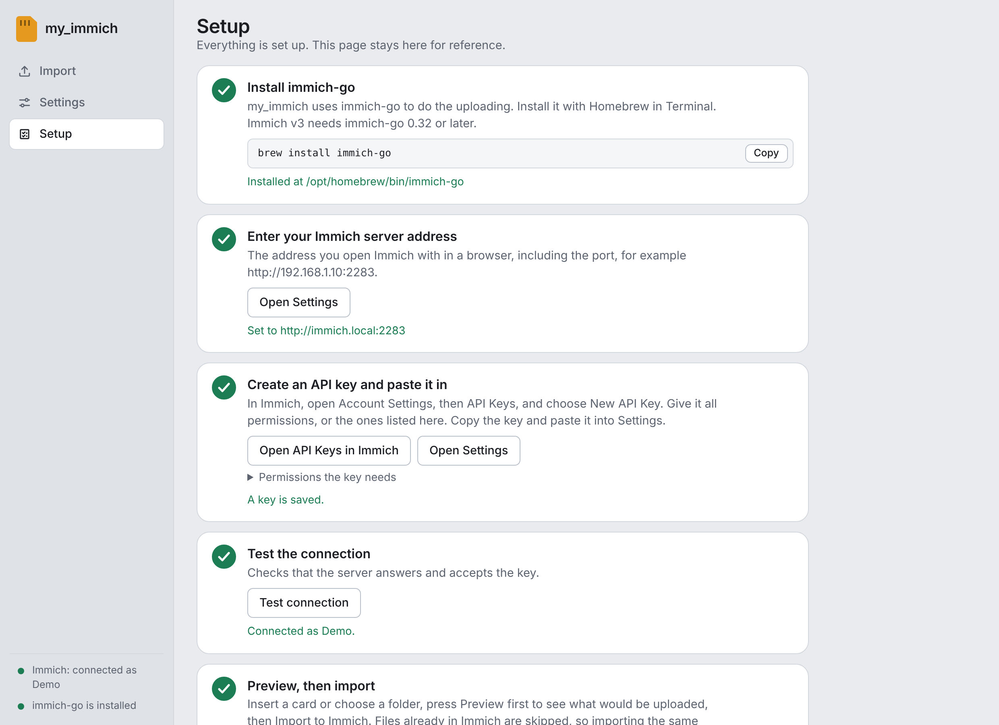

# my_immich

A small Mac app for getting photos into a self-hosted
[Immich](https://immich.app) server from a camera SD card, a USB drive, an
external disk or any folder. It sits in the menu bar,
opens a local page in your browser, and runs
[immich-go](https://github.com/simulot/immich-go) for you with settings that
stay put between imports.



- **Card aware.** Any mounted volume with a `DCIM` folder shows up as an SD
  card, with its subfolders, file count and size.
- **Any other source.** A folder chooser lists your USB drives and external
  disks next to Home, Pictures and recent folders, with a clickable path, a
  box to type or paste a path, and a count of the photos in each folder.
- **Editable settings.** Server, API key, RAW+JPEG handling, burst stacking,
  albums, import tag and more — saved to one file and reused every time.
- **Safe to repeat.** immich-go skips files Immich already has, so importing
  the same card twice uploads nothing new.
- **Dry run first.** Preview exactly what would be uploaded before sending
  anything.
- **Progress you can read.** Percentage, files done, time left, pace, and a
  contact sheet of the photos that "develops" from amber to colour as the
  import passes them.

## Screenshots

| Choosing a folder on an external drive | Settings, in dark mode |
|---|---|
|  |  |

| A finished import | The Setup guide |
|---|---|
|  |  |

The screenshots use demo data, not a real library or server.

## Requirements

- macOS (the page alone also runs on Linux)
- Python 3.8+ (`python3 --version`)
- immich-go 0.32 or later for Immich v3: `brew install immich-go`
- An Immich API key (see [API key permissions](#api-key-permissions))

## Install

```bash
cd ~/Documents/projects/my_immich
bash install.sh
open ~/Applications/my_immich.app
```

`install.sh` creates `~/Applications/my_immich.app` and a private Python
environment in `~/Library/Application Support/my_immich/` containing one
package, `rumps`, which draws the menu-bar icon. Nothing is installed
system-wide.

To start it at login, add my_immich under
System Settings → General → Login Items.

### Run without installing

```bash
python3 my_immich.py           # page only, no menu-bar icon
python3 my_immich.py --tray    # with the icon, if `rumps` is installed
```

Options: `--port 8765` (default) and `--no-browser`.

## Use

1. Launch my_immich. A card-shaped icon appears in the menu bar and the page
   opens at <http://127.0.0.1:8765>.
2. **Setup** — the page opens here until everything is ready. It walks through
   installing immich-go, entering the server address, creating an API key and
   testing the connection, ticking each step off as it is done.
   (**Settings** holds the same fields plus the import options. On first run
   the server and key are read from `~/scripts/sd-to-immich.sh` if it exists.)
3. **Import → From** — pick the card, or press **Choose folder** for anything
   else. Press **Look for cards and drives again** if you plugged something
   in after the page loaded.
4. **Preview first** — check the log; nothing is uploaded.
5. **Import to Immich** — the panel shows how far along it is (see
   [Progress](#progress)). **Stop** ends it early; running the import again
   continues where it left off.
6. Check the photos in Immich before formatting the card.

The menu-bar item shows whether a card is inserted and how the last import
ended, and sends a notification when a card appears or an import finishes.
**Quit** asks first if an import is running, because quitting stops it.

## Progress

While an import or preview runs, the panel on the right shows:

- **Phase and percentage.** First "Reading your Immich library", then
  "Uploading" with the current file name. The browser tab title shows the
  percentage too.
- **Done, Time left, Pace, Elapsed.** Time left and pace are estimates from
  the last minute of uploads.
- **Upload speed chart.** Megabytes a second over the last four minutes, with
  the current and peak values, measured from the sizes of the files as they
  finish.
- **Contact sheet.** Up to twelve photos spread evenly through the source.
  Frames start dim and amber and turn to full colour as the import reaches
  them. Thumbnails are made with macOS's `sips`, which reads camera RAW;
  videos and formats it cannot read show the file name instead.
- **Readouts.** Data sent so far; network traffic leaving this Mac (all apps,
  on the interface that reaches the server); how fast the server answers and
  its Immich version; immich-go's CPU and memory use; how many photos and
  videos your Immich holds and how many this run added; server disk space
  used and how much this run added. A readout is left out when its number is
  not available, for example when the API key lacks the permission.
- **Counters.** How many photos and videos immich-go found, uploaded, found
  already in Immich, found duplicated on the source, set aside by your
  settings, stacked, tagged, added to albums, or failed.
- **Latest files.** The last six files and what happened to each.
- **Result.** When it ends: finished, stopped or failed, and what was left
  out and why.

The full immich-go log is under "Show the full log", and opens by itself when
a run fails.

How it works: immich-go is asked to write its detailed log to a temporary
file (`--log-file`), which my_immich follows for the per-file events and
deletes afterwards. If your immich-go does not accept that flag, the import
is started again without it and the panel falls back to the numbers from
immich-go's one-line status.

## Importing from USB drives and external disks

Any folder works the same way as a card:

1. Press **Choose folder**, or one of the **Drives** buttons under it to jump
   straight to a plugged-in drive.
2. Move around by clicking folders, the path segments at the top, or the
   places on the left; or paste a path into the box and press Go.
3. The line at the bottom says how many photos and videos sit directly in the
   current folder. Subfolders are included in the import as well.
4. Press **Use this folder**, then **Preview first**.

Tips for big, old archives:

- Turn on **Albums from folders** in Settings if the folder names are worth
  keeping (for example `2019 Croatia`). Turn it off again for card imports.
- Import one top-level folder at a time. A stopped or failed import can be
  run again; files already in Immich are skipped.
- The first time you open Desktop, Documents, Downloads or an external drive,
  macOS may ask whether Python may access it. Allow it, or the folder shows
  as unreadable.
- Folders you imported from are remembered under **Recent**.

## Settings

| Setting | What it does | immich-go flag |
|---|---|---|
| Immich server | Address of your server, e.g. `http://192.168.50.17:30041` | `--server` |
| API key | Key created in Immich → Account Settings → API Keys | `--api-key` |
| RAW + JPEG pairs | Keep RAW only (default), keep JPEG only, stack, or upload both | `--manage-raw-jpeg` |
| Bursts | Leave separate (default) or stack burst sequences | `--manage-burst` |
| If a file fails | Stop the import (default) or skip the file and continue | `--on-errors` |
| Tag each import with its time | Adds a tag like `{immich-go}/2026-11-14 17:55:18` so a batch is easy to find | `--session-tag` |
| Pause Immich jobs while uploading | Holds thumbnailing etc. until the upload ends | `--pause-immich-jobs` |
| Keep the Mac awake | Runs the import under `caffeinate` | — |
| Eject the card when done | Ejects after a successful real import | — |
| HEIC + JPEG pairs | Same choices as RAW + JPEG, for HEIC | `--manage-heic-jpeg` |
| Albums from folders | One album per folder name or per full path | `--folder-as-album` |
| Put all into album | Adds everything in this import to one named album | `--into-album` |
| Upload | Photos and videos, photos only, or videos only | `--include-type` |
| immich-go path | Set only if it is not found automatically | — |
| Extra arguments | Anything else to pass to immich-go, e.g. `--date-range=2026` | — |
| Include subfolders | On by default; needed for `DCIM/100CANON` style cards | `--recursive` |

Settings live in `~/.config/my_immich/config.json`. **This file contains your
API key in plain text.** It is created readable by your account only; do not
copy it into this project folder or commit it.

## API key permissions

Create the key in Immich under Account Settings → API Keys with either all
permissions, or at least:

- `asset.read`, `asset.statistics`, `asset.update`, `asset.upload`,
  `asset.copy`, `asset.delete`, `asset.download`
- `album.create`, `album.read`, `albumAsset.create`
- `server.about`, `stack.create`, `tag.create`, `tag.asset`, `user.read`
- `job.create`, `job.read` (only for "Pause Immich jobs"; needs an admin
  account's key)

An import that stops with `Missing required permission: …` names the one to
add.

## Troubleshooting

| Problem | What to check |
|---|---|
| No menu-bar icon after launching | Read `~/Library/Logs/my_immich.log`. Re-run `bash install.sh` if it mentions `rumps`. |
| Setup says immich-go was not found | `brew install immich-go`, or set its full path under More options. |
| "Cannot reach …" on Test connection | You are off the home network/VPN, or the address or port is wrong. |
| "… answered HTTP 403 Forbidden" on Test connection | The address is right, but something in front of Immich (Cloudflare, an access gateway, a reverse-proxy rule) refused the request. Allow this Mac or the `my_immich` user agent there, or use the local address. |
| "API key was refused" | The key is wrong or lacks `user.read`; see the list above. |
| Card not listed | It must be mounted and contain a `DCIM` folder. Press "Look for cards and drives again", or use Choose folder. |
| A folder shows "macOS did not allow reading this folder" | System Settings → Privacy & Security → Files and Folders: allow Python (my_immich) for that location. |
| Page says it lost contact | The app was quit. Launch it again. |
| Port 8765 is taken | The app tries the next 19 ports; the menu-bar **Open my_immich** item always goes to the right one. |

## Update and uninstall

- After changing `my_immich.py`: quit the app, run `bash install.sh` again.
- Remove the app: `bash uninstall.sh` (add `--all` to delete settings and the
  stored API key as well).

## Project layout

```
my_immich.py        the whole app: local web server, page, import runner, menu-bar icon
install.sh          builds ~/Applications/my_immich.app (with its icon) and its Python environment
assets/             menu-bar icon and app icon, as SVG sources and rendered PNGs
uninstall.sh        removes them
requirements.txt    rumps (menu-bar icon only)
tests/              unit tests: python3 -m unittest discover -s tests -v
docs/               screenshots used in this README
CLAUDE.md           notes for working on the code
```

## How it works

`my_immich.py` starts a web server bound to `127.0.0.1` only. The page talks
to it over a small JSON API guarded by a per-launch token and a Host-header
check, so other websites and other machines cannot drive it. Pressing Import
starts `immich-go upload from-folder … --no-ui <source>` as a child process
and streams its output to the page with the API key masked.

## Known limits

- The page, settings, folder chooser and import logic are covered by the
  tests. Launching the app has been confirmed on a Mac; notifications and
  card eject have not been exercised yet. Report what
  `~/Library/Logs/my_immich.log` says if something is off.
- One import at a time.
- The API key is passed to immich-go on its command line, so other processes
  running as your user can see it while an import runs.
- No album suggestions yet; organising a tagged batch is a separate step.
